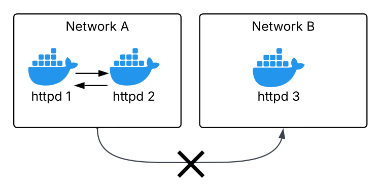
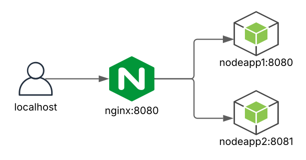

## Docker communication between networks

The containers can only communicate when their are in the same network.  

[see readme.md](docker/labs/network/1-communication-between-networks/readme.md)

 

## Nginx redirects to nodes

• two node containers and nginx inside the network (backendnet).  
• the `nginx.conf` file is volume binded.  
• nginx on port 80 redirects to the two node containers. 

[see readme.md](nginx/labs/2-nginx-redirect-to-nodes/readme.md)

| Problema | Estrutura de dados principal | O que o problema avalia |
|---|---|---|
| **Seat Manager** | Min-Heap | Recuperar o menor elemento disponível eficientemente |
| **LRU Cache** | Hash Map + Doubly Linked List | Gerenciar dados com limite de capacidade e política de descarte |
| **Min Stack** | Stack | Recuperar o menor elemento em O(1) |
| **Design Twitter** | Hash Map + Heap | Combinar dados de usuários e recuperar os itens mais recentes |
| **Time-Based Key-Value Store** | Hash Map + Binary Search | Recuperar valores associados a timestamps |
| **Number of Recent Calls** | Queue | Manter somente os eventos dentro de uma janela temporal |
| **Moving Average from Data Stream** | Queue | Calcular médias continuamente sem recalcular todos os elementos |
| **Design HashMap** | Array ou Hashing | Implementar uma estrutura fundamental sem utilizar sua implementação pronta |
| **Implement Queue using Stacks** | Stack | Construir uma estrutura utilizando outra estrutura de dados |
| **Find Median from Data Stream** | Two Heaps | Manter a mediana de uma sequência de números recebidos continuamente |